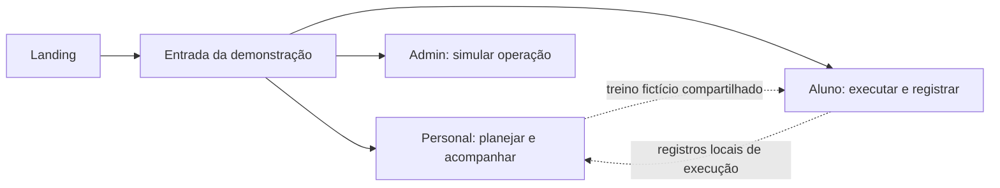

# Direção das experiências

Todas as composições abaixo são especificações para a próxima etapa, sem interfaces implementadas. Os quatro ambientes compartilham identidade, mas têm densidade e tarefas diferentes.

## Landing page · tornar o acompanhamento compreensível

Composição editorial assimétrica, fundo off-white, título grande à esquerda e representação do percurso do treino à direita. Verde profundo em uma seção de narrativa e lima em detalhes controlados. Fotografias, se usadas no futuro, mostram contexto real de orientação, com diversidade de corpos e idades e licença verificada; não depender de banco de imagens para estabelecer a identidade.

Ordem de conteúdo:

1. Cabeçalho com marca, Como funciona, Para o aluno e botão “Explorar demonstração”.
2. Hero: **“Seu cuidado, presente em cada treino.”** Apoio: “Organize alunos, prescreva treinos e acompanhe o próximo passo de cada pessoa.” CTA abre o ambiente demonstrativo do personal.
3. Percurso em três etapas: planejar → executar → acompanhar. Mostrar relações, em vez de uma grade de recursos iguais.
4. Duas perspectivas complementares: rotina do personal e treino do aluno, com acesso às demonstrações.
5. Faixa editorial sobre continuidade: agenda e histórico dão contexto para o próximo contato.
6. FAQ sobre o que está demonstrado, uso mobile e limites do protótipo. Rodapé com identificação da demonstração.

Sem depoimentos inventados, números de clientes, preços, teste grátis ou checkout até existir oferta aprovada. O acesso à demonstração não coleta dados pessoais nem cria conta.

## Painel do personal · decidir quem precisa de atenção hoje

Cabeçalho com data e ação “Novo treino”. Coluna principal com próximos atendimentos em agenda vertical; uma lista “Acompanhar” explica fatos como “sem registro há 7 dias”. Uma faixa compacta de indicadores fornece contexto, sem dominar a tela. Evitar classificar alunos como “desengajados” sem critério explícito.

Navegação proposta: Visão geral, Alunos, Treinos e Agenda. Perfil e configurações são secundários e podem ser identificados como demonstrativos até ganharem fluxo próprio.

| Tela futura | Tarefa principal | Interação verificável |
| --- | --- | --- |
| Visão geral | Priorizar o dia | Abrir aluno ou sessão a partir das listas |
| Alunos | Localizar pessoa | Busca por nome, filtros e estado sem resultados |
| Detalhe do aluno | Entender contexto | Alternar resumo, treinos e evolução; abrir treino |
| Editor de treino | Preparar prescrição | Adicionar exercício, editar séries/reps/descanso, reordenar por botões e validar |
| Agenda | Organizar atendimento | Criar/editar sessão fictícia e tratar conflito de horário local |

Evolução só apresenta gráficos quando o período e os dados justificarem; rótulos e tabela acompanham. Nenhuma prescrição automática ou diagnóstico.

## Aplicativo do aluno · executar o próximo exercício com clareza

Prioridade mobile, superfície clara e contexto de treino em verde profundo. Início com o treino do dia e uma única ação principal. Navegação: Hoje, Treinos, Evolução e Perfil. Na sessão ativa, reduzir a navegação para favorecer execução e retorno seguro.

Fluxo: abrir treino → ver prescrição → iniciar → registrar kg e repetições por série → concluir série → controlar descanso → finalizar sessão → revisar resumo.

Exercício em destaque com nome, instrução curta e prescrição separada dos valores executados. Cargas anteriores aparecem como referência, sem preenchimento ambíguo. Teclado numérico adequado, aceitando decimal pt-BR para kg. Validação diferencia vazio de zero e não inventa limites clínicos.

Conclusão exige registro coerente ou confirmação explícita de séries não executadas. Permitir corrigir uma série, pausar/pular descanso e sair com aviso sobre o estado local. O resumo informa exatamente o que foi registrado na demonstração; recarregar reinicia os dados.

Evolução compara a pessoa consigo mesma. Sem ranking de corpos, mensagens punitivas ou sequências diárias que culpem o aluno.

## Administração do SaaS · operar com rastreabilidade

Ambiente separado, de maior densidade e identidade mais discreta: off-white, tabelas brancas, verde para navegação, lima apenas em seleção/ação apropriada. Cabeçalho sempre identifica a organização em contexto; não misturar dados globais e dados de um tenant sem explicitar o escopo.

Navegação proposta: Organizações, Planos, Assinaturas e Auditoria. Tabelas com busca, filtros, estado, paginação e detalhe. A visão inicial prioriza organizações e assinaturas; métricas financeiras só com definições e dados confiáveis.

No protótipo, visualizar organização, filtrar status, abrir detalhe e simular mudança de plano/estado com confirmação. Exibir “Simulação: nenhuma assinatura será alterada ou cobrada”. Planos são exemplos rotulados, sem preços comerciais definidos. Linha de auditoria demonstrativa pode registrar a ação local com o rótulo de simulação.

Não permitir acesso operacional a dados de saúde de alunos por conveniência. Nenhuma impersonação ou alteração real de cobrança. Se uma ação não for construída, rotular “Disponível em etapa futura” e oferecer explicação; não criar botões sem resposta.

## Relação entre ambientes

O seletor de ambiente da demonstração precisa indicar que muda a visualização, sem autenticar ou atribuir permissões reais.
